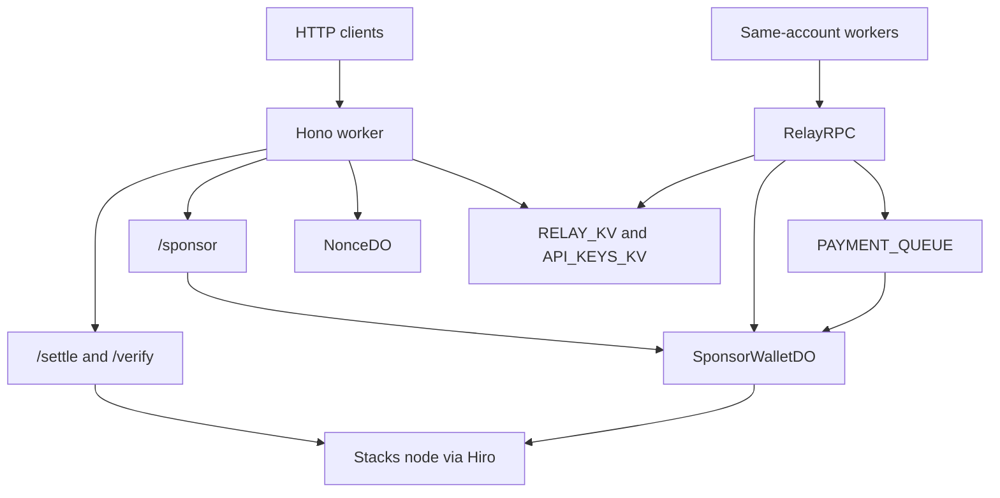

# x402 Stacks Sponsor Relay

A Cloudflare Worker that settles [x402](https://github.com/coinbase/x402/blob/main/specs/x402-specification-v2.md) payments on the Stacks blockchain. Agents and resource servers need a facilitator that can check a signed Stacks transfer (recipient, amount, and token) and broadcast it without running a node. This worker does that locally, then sends the transaction to the Stacks network. Public callers settle self-paid transactions. Fee sponsorship — the sponsor wallet pays the STX fee — is limited to API-key holders on `POST /sponsor` and to trusted same-account workers on the `RelayRPC` service binding, so the public settle endpoint cannot drain the sponsor wallet.

| | |
|---|---|
| Staging (testnet) | https://x402-relay.aibtc.dev |
| Production (mainnet) | https://x402-relay.aibtc.com |
| OpenAPI | `/openapi.json` |
| Swagger UI | `/docs` |
| Agent quick-start | `/llms.txt` |

## Features

- **x402 V2 facilitator.** `POST /settle` verifies a payment and broadcasts it. `POST /verify` validates locally and does not broadcast. `GET /supported` advertises scheme `exact`, the worker's CAIP-2 network, and the `payment-identifier` extension.
- **Self-paid public settlement.** `/settle` accepts a standard transaction (the sender pays its own fee) or one that already has a sponsor signature. A transaction built with an empty sponsor slot (`sponsored: true`, fee 0) is rejected with `invalid_transaction_state`.
- **Sponsored broadcast.** `POST /sponsor` requires an API key, co-signs a pre-signed sponsored transaction with `PAYMENT_SPONSOR_PRIVATE_KEY`, and broadcasts it. It does not check x402 payment requirements.
- **Internal gasless payments.** Same-account workers call `RelayRPC`: `sponsorPayment` (sponsor and broadcast now), `submitPayment` (enqueue and return a `paymentId`), `checkPayment`, and `getSponsorStatus`. The public `GET /status/sponsor` returns the same readiness snapshot.
- **Idempotency.** A `payment-identifier` (`pay_` plus 16–128 characters of `[a-zA-Z0-9_-]`) returns the cached result for the same payload and `409` when the same id is reused with a different payload. Identical transaction hex is also deduplicated.
- **Queued payments.** `submitPayment` is consumed serially from `PAYMENT_QUEUE`. Callers poll `GET /payment/:id` (`queued`, `broadcasting`, `mempool`, `confirmed`, `failed`, `replaced`, `not_found`). Hiro chainhooks can post confirmations to `POST /webhook/chainhook`.
- **API keys.** Free-tier keys can be provisioned by signing a fixed message with a Bitcoin key (`POST /keys/provision`, BIP-137 or BIP-322) or a Stacks key (`POST /keys/provision-stx`). Keys last 30 days. Tiers are `free` (10/min, 100/day, 100 STX fee cap), `standard` (60/min, 10,000/day, 1,000 STX), and `unlimited`.
- **SIP-018 auth.** Optional on `POST /sponsor`. Required, via the `X-SIP018-Auth` header, to read or cancel your own sponsor queue (`GET /queue/:senderAddress`, `DELETE /queue/:senderAddress/:walletIndex/:sponsorNonce`).
- **Receipts from the removed relay.** `POST /relay` no longer exists and no new receipts are issued. `GET /verify/:receiptId` and `POST /access` still honor receipts already stored in KV.
- **Operations.** Clamped fee estimates (`GET /fees`), a public stats API (`GET /stats`) and HTML dashboard (`GET /dashboard`), sponsor-wallet inventory (`GET /wallets`), and nonce-pool diagnostics. A cron trigger runs every five minutes for settlement health and optional Telegram sponsor alerts.
- **Agent discovery.** `/llms.txt`, `/llms-full.txt`, `/topics`, and `/.well-known/agent.json`.

Supported payment assets are STX, sBTC, and USDCx (or a CAIP-19 contract address on the V2 endpoints). Networks are `stacks:1` (mainnet) and `stacks:2147483648` (testnet), selected by `STACKS_NETWORK`.

## Architecture



`SponsorWalletDO` is the single payment-sponsor wallet. It signs with `PAYMENT_SPONSOR_PRIVATE_KEY`, reads the sponsor nonce from the chain at broadcast time, and enforces a daily fee budget (default 10 STX, overridable with `SPONSOR_DAILY_BUDGET_USTX`). `POST /sponsor` spends a separate budget (`budget:sponsor`) so API-key traffic does not consume the x402 payment budget. `RelayRPC.sponsorPayment` is also limited by the `SPONSOR_RATE_LIMIT` binding (10 requests per 60 seconds per payer, as configured in `wrangler.jsonc`).

`NonceDO` coordinates the multi-wallet pool derived from `SPONSOR_MNEMONIC` (accounts `0..SPONSOR_WALLET_COUNT-1`, up to 10). Each wallet allows 20 in-flight sponsored transactions. That pool backs nonce diagnostics, gap-fill, and operator routes such as `GET /nonce/state`. `SPONSOR_PRIVATE_KEY` is a single-key fallback and only covers wallet index 0.

`StatsDO` stores aggregate counters. `RELAY_KV` holds receipts, settlement dedup, the fee cache, health history, and payment records. `API_KEYS_KV` holds API keys. A dead-letter queue marks payments that exhaust queue retries so they are not left in `queued`.

First-party workers should prefer the service binding over HTTP. The contract is written up in [docs/post-337-downstream-contracts.md](docs/post-337-downstream-contracts.md).

## Prerequisites

- Node.js 22 (the version used in CI) and npm
- A Cloudflare account and Wrangler login if you deploy or manage remote KV keys
- For `POST /sponsor` and `RelayRPC` sponsorship: `PAYMENT_SPONSOR_PRIVATE_KEY` and the `SPONSOR_WALLET_DO` binding
- For the multi-wallet nonce pool: a funded Stacks wallet as a 12- or 24-word `SPONSOR_MNEMONIC` (or `SPONSOR_PRIVATE_KEY` for wallet 0 only)
- For the manual scripts under `scripts/`: a Stacks account in `.env` (`AGENT_MNEMONIC` or `AGENT_PRIVATE_KEY`)

## Installation

```bash
npm install
cp .env.example .env
npm run dev
```

`npm run dev` starts Wrangler on the local worker. Most scripts under `scripts/` call `http://localhost:8787` unless `RELAY_URL` is set. The `dev`, test, and `keys` scripts load `.env` before they run. `.env` is gitignored.

```bash
npm test          # unit tests (Vitest)
npm run check     # tsc --noEmit
npm run deploy:dry-run
```

## Configuration

Set worker vars in `wrangler.jsonc`. Set secrets with `wrangler secret put` (or in `.env` / `.dev.vars` for local Wrangler). Names only:

**Vars**

| Name | Role |
|---|---|
| `STACKS_NETWORK` | `testnet` or `mainnet` |
| `SPONSOR_WALLET_COUNT` | Wallets derived from the mnemonic (code default `1`; this repo sets `10`) |
| `SPONSOR_WALLET_MAX` | Ceiling for dynamic pool scaling |
| `FLUSH_RECIPIENT` | Recipient of nonce gap-fill transfers |
| `ENABLE_SETTLE_RESPONSOR` | Declared in the worker env and set to `false` in `wrangler.jsonc`. The current `POST /settle` handler does not read it; an empty sponsor slot is always rejected |
| `USE_WALLET_CAPACITY_STATE` | Wallet-capacity shape for `NonceDO` (default on) |
| `SPONSOR_DAILY_BUDGET_USTX` | Daily sponsor fee cap in microSTX (default 10 STX) |
| `SPONSOR_ALERT_MIN_USTX` | Low-balance alert threshold in microSTX (default 10 STX) |
| `BROADCAST_NODE_URLS` | Comma-separated fallback Stacks node URLs |
| `RELAY_BASE_URL` | Base URL embedded in payment status links |

**Secrets**

| Name | Role |
|---|---|
| `PAYMENT_SPONSOR_PRIVATE_KEY` | Hex key for `SponsorWalletDO` (public `/sponsor` and RPC sponsorship) |
| `SPONSOR_MNEMONIC` | Mnemonic for the multi-wallet nonce pool |
| `SPONSOR_PRIVATE_KEY` | Fallback hex key; wallet index 0 only |
| `HIRO_API_KEY` | Optional Hiro API key for higher rate limits |
| `CHAINHOOK_AUTH_TOKEN` | Bearer token required by `POST /webhook/chainhook` |
| `TELEGRAM_BOT_TOKEN` | Sponsor alerts; both Telegram vars are required to send |
| `TELEGRAM_CHAT_ID` | Sponsor alert destination |

**Bindings** (declared in `wrangler.jsonc`, not secrets): `LOGS`, `RELAY_KV`, `API_KEYS_KV`, `NONCE_DO`, `STATS_DO`, `SPONSOR_WALLET_DO`, `SPONSOR_RATE_LIMIT`, `PAYMENT_QUEUE`.

**Local scripts** (`.env`, see `.env.example`):

| Name | Role |
|---|---|
| `AGENT_MNEMONIC` | Test account mnemonic |
| `AGENT_PRIVATE_KEY` | Test account hex key, if no mnemonic |
| `AGENT_ACCOUNT_INDEX` | Derivation index (default `0`) |
| `RELAY_URL` | Target worker (default `http://localhost:8787`) |
| `TEST_API_KEY` | Key for `npm run test:sponsor` and the SIP-018 sponsor script |
| `TEST_RECIPIENT` | Payment recipient used by the test scripts |
| `WRANGLER_ENV` | `staging` or `production` for `npm run keys` |
| `KV_NAMESPACE_ID` | Optional override for the keys CLI |

Deploy with the scripts in `package.json` after secrets are set for that environment:

```bash
npx wrangler secret put PAYMENT_SPONSOR_PRIVATE_KEY --env staging
npm run deploy:staging
npm run deploy:production
```

## Usage

Build a self-paid STX transfer with `@stacks/transactions` v7 (`serialize()` already returns hex) and settle it. `amount` is microSTX and must match the transaction. On staging, `network` is `stacks:2147483648`.

```typescript
import { AnchorMode, makeSTXTokenTransfer } from "@stacks/transactions";

const recipient = "ST...";
const transaction = await makeSTXTokenTransfer({
  recipient,
  amount: 1000n,
  senderKey: privateKey,
  network: "testnet",
  anchorMode: AnchorMode.Any,
  sponsored: false,
  fee: 1000n,
});

const response = await fetch("https://x402-relay.aibtc.dev/settle", {
  method: "POST",
  headers: { "Content-Type": "application/json" },
  body: JSON.stringify({
    x402Version: 2,
    paymentPayload: {
      x402Version: 2,
      payload: { transaction: transaction.serialize() },
    },
    paymentRequirements: {
      scheme: "exact",
      network: "stacks:2147483648",
      amount: "1000",
      asset: "STX",
      payTo: recipient,
      maxTimeoutSeconds: 60,
    },
  }),
});

const result = await response.json();
// { success, payer, transaction, network } — HTTP 200 even when success is false
```

`POST /verify` takes the same body and returns `{ isValid, payer?, invalidReason? }` without broadcasting.

Sponsor a transaction that was built with `sponsored: true` and fee `0`:

```bash
curl -s https://x402-relay.aibtc.dev/sponsor \
  -H "Authorization: Bearer $TEST_API_KEY" \
  -H "Content-Type: application/json" \
  -d '{"transaction":"'"$TX_HEX"'"}'
```

A successful body is `{ success, requestId, txid, explorerUrl, fee }` with `fee` in microSTX.

Provision a free-tier key. The timestamp must be within five minutes; the bare message without a timestamp is the registration path.

```json
POST /keys/provision-stx
{
  "stxAddress": "ST...",
  "signature": "0x...",
  "message": "Bitcoin will be the currency of AIs | 2026-02-16T12:00:00.000Z"
}
```

The API key is returned once. Manage keys against remote KV with:

```bash
WRANGLER_ENV=staging npm run keys -- create --app "My App" --email "dev@example.com"
WRANGLER_ENV=staging npm run keys -- list
WRANGLER_ENV=staging npm run keys -- info "$TEST_API_KEY"
WRANGLER_ENV=staging npm run keys -- usage "$TEST_API_KEY" --days 7
WRANGLER_ENV=staging npm run keys -- renew "$TEST_API_KEY"
WRANGLER_ENV=staging npm run keys -- revoke "$TEST_API_KEY"
```

Same-account workers bind the entrypoint and call it directly. The `service` name is the deployed worker name from `wrangler.jsonc`, not the npm package name:

```jsonc
// local:      "x402-sponsor-relay"
// staging:    "x402-sponsor-relay-staging"
// production: "x402-sponsor-relay-production"
{ "binding": "X402_RELAY", "service": "x402-sponsor-relay-staging", "entrypoint": "RelayRPC" }
```

```typescript
const sponsored = await env.X402_RELAY.sponsorPayment(txHex, settle);
const queued = await env.X402_RELAY.submitPayment(txHex, settle);
if (queued.accepted) {
  const status = await env.X402_RELAY.checkPayment(queued.paymentId);
}
const ready = await env.X402_RELAY.getSponsorStatus();
```

Manual checks against a running worker:

```bash
npm run test:settle
npm run test:sponsor
npm run test:fees
npm run test:provision
npm run test:provision-stx
npm run test:sip018-auth
```

Pass a URL to override `RELAY_URL`: `npm run test:fees -- http://localhost:8787`.

## Project structure

```
src/index.ts                 HTTP app, cron, and queue dispatch
src/rpc.ts                   RelayRPC service binding
src/endpoints/               Route handlers
src/services/                Settlement, sponsorship, keys, fees, receipts
src/durable-objects/         NonceDO, StatsDO, SponsorWalletDO
src/queue-consumer.ts        Payment queue and dead-letter handling
src/routes/discovery.ts      /llms.txt, /topics, agent card
src/dashboard/               HTML dashboard
src/middleware/              Logging, API-key auth, malformed-payload tracking
scripts/                     Manual endpoint scripts and the keys CLI
docs/                        Downstream contracts and operator notes
wrangler.jsonc               Worker config, bindings, staging and production
```

Operator notes worth reading next to the code: [docs/post-337-downstream-contracts.md](docs/post-337-downstream-contracts.md), [docs/nonce-pool-operations.md](docs/nonce-pool-operations.md), and [docs/sponsor-ledger-lifecycle.md](docs/sponsor-ledger-lifecycle.md). Live endpoint reference is `GET /docs` and `GET /llms-full.txt`.

## License

This repository does not include a license file.
